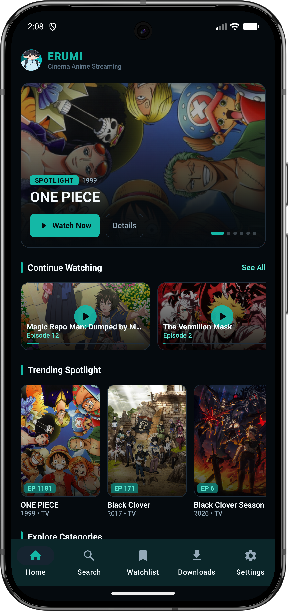
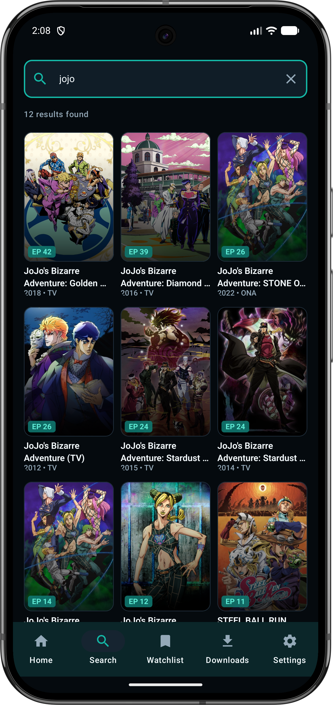
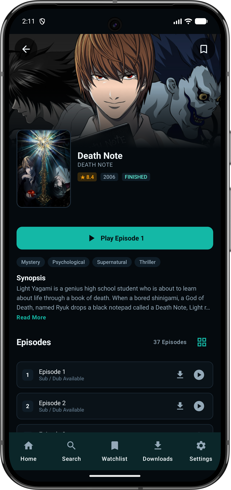
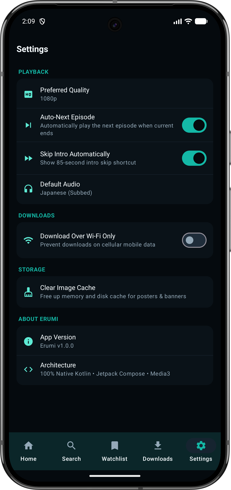
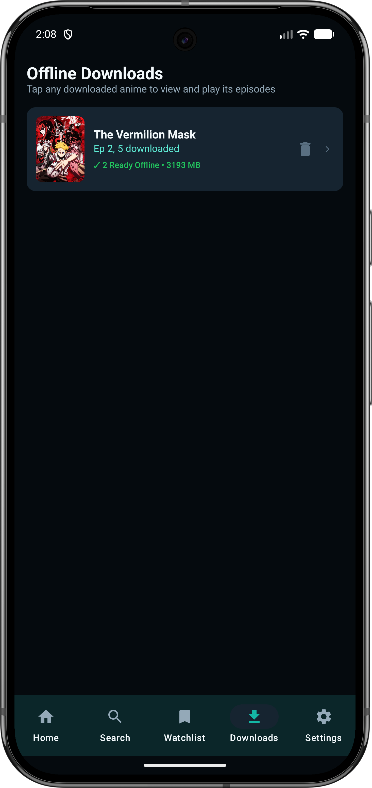
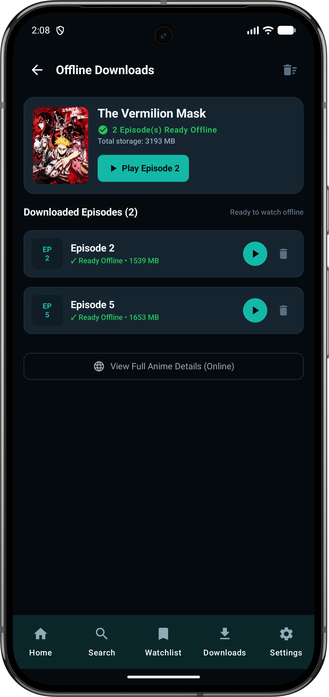
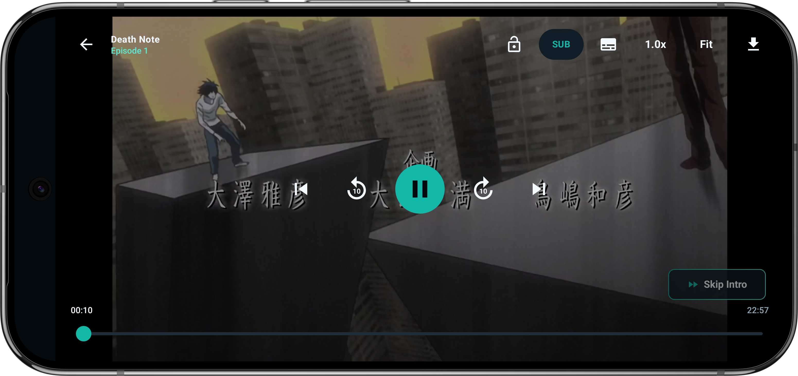

<div align="center">


# E R U M I &nbsp; N A T I V E &nbsp; エルミ

**A Cinema-Grade Standalone Android Anime Streaming Experience**

---

</div>

---

## Overview

> **Erumi Native** is a 100% standalone native Android anime streaming platform built with modern Android technologies. Eliminating all dependencies on external servers, companion PC applications, or WebView wrappers, it delivers a cinema-grade viewing experience entirely on your Android device.

### Key Highlights

- **100% Standalone** – No Windows PC, no ErumiServer.exe, no local Wi-Fi proxy needed
- **Cinema Player** – AndroidX Media3 ExoPlayer with HLS streaming, adaptive bitrate, and hardware acceleration
- **Smart Search** – Multi-source fuzzy matching across AllAnime and AniList GraphQL APIs
- **Offline Support** – Download episodes for offline viewing with zero internet connection
- **Dark Cinema Design** – Material 3 theme optimized for OLED displays
- **Anti-Hotlinking** – On-the-fly PNG disguise header stripping in the media pipeline

---

## App Screenshots

<table>
  <tr>
    <td align="center"><br><b>Home</b></td>
    <td align="center"><br><b>Search</b></td>
    <td align="center"><br><b>Anime Details</b></td>
  </tr>
  <tr>
    <td align="center"><br><b>Settings</b></td>
    <td align="center"><br><b>Downloads</b></td>
    <td align="center"><br><b>Offline Detail</b></td>
  </tr>
  <tr>
    <td align="center" colspan="3"><br><b>Video Player</b></td>
  </tr>
</table>

---

## Features

### Cinema Video Player

- **Native HLS Streaming** – `.m3u8` adaptive bitrate playback (1080p, 720p, auto)
- **Landscape Fullscreen** – Auto-orientation lock with immersive system bars
- **Anti-Hotlinking Protection** – Real-time PNG disguise header stripping in Media3 DataSource
- **Subtitle Support** – WebVTT overlay tracks with customizable size
- **Audio Switching** – Instant toggle between Sub/Dub audio tracks
- **Playback Controls** – Speed selection (0.5× - 2×), seek, play/pause
- **Intro Skip** – One-tap 85-second intro skip button
- **Auto-Next Episode** – Seamless automatic episode progression

### Advanced Search Engine

- **Multi-Source Search** – Simultaneous queries across AllAnime and AniList GraphQL APIs
- **Fuzzy Matching** – Character bigram similarity with exact title weighting
- **Season Detection** – Smart identification of seasons and parts
- **Waterfall Resolution** – Fallback through HiAnime → AniDB → AniNeko sources
- **Search History** – Quick access to recent queries

### Local User Library

- **Continue Watching** – Resume cards with percentage progress tracking
- **Watch History** – Complete logs with timestamps and purge options
- **Watchlist** – Personal bookmarking for favorite anime
- **Offline Downloads** – Full episode downloads for offline playback
- **Storage Management** – Track download progress and storage usage

### Dark Cinema Design System

- **Primary Accent** – `#14B8A6` (Teal)
- **Deep Background** – `#090D12` (Cinema Black)
- **Material 3** – Modern responsive layouts with smooth transitions
- **OLED Optimized** – True black backgrounds for power efficiency

---

## Architecture

Erumi Native follows **Clean Architecture** principles with MVVM pattern:

```
┌────────────────────────────────────────────────────────┐
│                   PRESENTATION LAYER                   │
│   • Jetpack Compose UI (Material 3 Dark Cinema Theme)  │
│   • ViewModels (StateFlow & Coroutines)                │
│   • Navigation Component (ErumiNavGraph)               │
└───────────────────────────▲────────────────────────────┘
                            │
┌───────────────────────────┴────────────────────────────┐
│                      DOMAIN LAYER                      │
│   • Business Models (Anime, Episode, StreamSource)     │
│   • Repository Interfaces                              │
│   • Engine Resolvers (EpisodeResolver, FuzzyMatcher)   │
└───────────────────────────▲────────────────────────────┘
                            │
┌───────────────────────────┴────────────────────────────┐
│                       DATA LAYER                       │
│   • Data Sources (AllAnime, AniList, HiAnime, etc.)    │
│   • Room Database (AppDatabase & DAOs)                 │
│   • DataStore Preferences                              │
│   • Media3 DataSource & Download Service               │
└────────────────────────────────────────────────────────┘
```

### Project Structure

```
app/src/main/java/com/erumi/nativeapp/
├── core/
│   ├── common/        # Constants, Resource wrapper
│   ├── database/      # Room AppDatabase, DAOs, Entities
│   ├── datastore/     # UserPreferencesDataStore
│   ├── download/      # Media3 ErumiDownloadService
│   ├── network/       # ApiClient, DisguiseHeaderDataSource
│   └── utils/         # FuzzyMatcher, OtakuCipher
├── data/
│   └── repository/    # AnimeRepository, UserLibraryRepository
├── domain/
│   └── model/         # Business domain entities
├── engine/
│   ├── sources/       # AllAnimeSource, AniListSource, etc.
│   └── resolver/      # EpisodeResolver waterfall pipeline
├── features/
│   ├── home/          # Home screen with Featured Banner
│   ├── search/        # Search bar and results grid
│   ├── anime_details/ # Synopsis, relations, episode drawer
│   ├── player/        # Media3 cinema player
│   ├── watchlist/     # Saved anime collection
│   ├── history/       # Watch history logs
│   ├── downloads/     # Offline download manager
│   └── settings/      # Playback and app settings
├── navigation/        # Jetpack Compose Navigation graph
├── ui/
│   ├── components/    # Reusable UI components
│   └── theme/         # Color, Type, Theme definitions
├── ErumiApplication.kt
└── MainActivity.kt
```

---

## Tech Stack

### Core Technologies

| Component | Technology | Version |
|-----------|-----------|---------|
| **Language** | Kotlin | 1.9.22 |
| **UI Framework** | Jetpack Compose | BOM 2024.02.00 |
| **Design System** | Material 3 | - |
| **Architecture** | MVVM + Clean Architecture | - |
| **Min SDK** | Android 8.0 (API 26) | - |
| **Target SDK** | Android 14 (API 34) | - |

### Media & Networking

| Purpose | Library | Version |
|---------|---------|---------|
| **Media Engine** | AndroidX Media3 ExoPlayer | 1.3.0 |
| **HLS Support** | media3-exoplayer-hls | 1.3.0 |
| **Player UI** | media3-ui | 1.3.0 |
| **Downloads** | media3-database | 1.3.0 |
| **Networking** | OkHttp | 4.12.0 |
| **Serialization** | Gson | 2.10.1 |
| **Image Loading** | Coil Compose | 2.6.0 |

### Data Storage

| Purpose | Library | Version |
|---------|---------|---------|
| **Database** | AndroidX Room | 2.6.1 |
| **Preferences** | AndroidX DataStore | 1.0.0 |

### Background Processing

| Purpose | Library | Version |
|---------|---------|---------|
| **Work Manager** | AndroidX WorkManager | 2.9.0 |
| **Coroutines** | kotlinx-coroutines-android | 1.7.3 |

### Data Sources

- AllAnime – GraphQL API for catalog and search
- AniList – GraphQL API for metadata and relations
- HiAnime – Primary video stream source with OtakuCipher decryption
- AniDB – Secondary stream fallback
- AniNeko – Tertiary stream fallback

---

## Database Schema

### Room Database Entities

| Entity | Primary Key | Description |
|--------|-------------|-------------|
| `AnimeEntity` | `id: String` | Cached anime metadata, synopsis, titles, episodes count, ratings |
| `EpisodeEntity` | `id: String` | Cached episode numbers and provider IDs |
| `WatchHistoryEntity` | `id: String` | Watch history log with timestamps, position, duration |
| `ContinueWatchingEntity` | `animeId: String` | Active resume shelf items (5s-95% progress) |
| `WatchlistEntity` | `animeId: String` | User-saved anime bookmarks |
| `DownloadEntity` | `id: String` | Download queue status, progress, file paths |
| `SearchHistoryEntity` | `query: String` | Recent search queries |

### DataStore Preferences

Stored in `erumi_preferences.preferences_pb`:

- `preferred_quality` – "1080p", "720p", "Auto"
- `auto_next_episode` – Boolean (default: true)
- `default_audio` – "sub", "dub"
- `default_subtitle_lang` – "en"
- `subtitle_size` – Float (default: 1.0f)
- `skip_intro` – Boolean (default: true)
- `wifi_only_downloads` – Boolean (default: false)
- `app_theme` – "Dark Cinema"

---

## Getting Started

### Prerequisites

- JDK 17 or higher
- Android SDK (API 34)
- Gradle 8.3.0
- Android Studio (recommended)

### Clone the Repository

```bash
git clone https://github.com/yourusername/erumi-native.git
cd erumi-native
```

### Build Debug APK

```bash
./gradlew assembleDebug
```

Or on Windows:

```bat
build_apk.bat
```

Output: `app/build/outputs/apk/debug/app-debug.apk`

### Build Release APK

```bash
./gradlew assembleRelease
```

Output: `app/build/outputs/apk/release/app-release-unsigned.apk`

**Note:** Configure signing in `app/build.gradle.kts` for release builds.

### Install on Device

```bash
adb install app/build/outputs/apk/debug/app-debug.apk
```

---

## Installation

### Option 1: Build from Source

Follow the build instructions above to compile and install the APK.

### Option 2: Download Pre-built APK

Download the latest release from the [Releases](https://github.com/jhudel26/Erumi-Android-App/releases/tag/v1.0.0) page.

**Note:** Enable "Install from Unknown Sources" in device settings.

---

## Feature Details

### Video Playback

- Multi-quality streaming with adaptive bitrate
- Native HLS (`.m3u8`) support
- WebVTT subtitles with customizable size
- Instant Sub/Dub audio switching
- Playback speed control (0.5× - 2×)
- One-tap intro skip (85 seconds)
- Auto-advance to next episode

### Search & Discovery

- Fuzzy matching for typos and alternative titles
- Multi-source search (AllAnime + AniList)
- Season/part detection
- Recent search history
- Popular tag browsing

### Offline Downloads

- Full episode downloads
- Download progress tracking
- Offline playback without internet
- Wi-Fi only download option

### User Library

- Continue watching with progress tracking
- Complete watch history logs
- Watchlist for bookmarking
- Visual progress indicators

---

## Configuration

### Network Settings

- OkHttp with connection pooling
- SSL tolerance for compatibility
- Custom User-Agent headers

### Player Settings

Available in Settings screen:
- Preferred video quality
- Default audio language
- Subtitle language and size
- Auto-next episode toggle
- Skip intro toggle

### Storage Management

- Clear cache to free space
- Manage downloaded episodes
- View storage usage breakdown

---

## Contributing

Contributions are welcome! Please follow these guidelines:

1. Fork the repository
2. Create a feature branch (`git checkout -b feature/amazing-feature`)
3. Commit your changes (`git commit -m 'Add some amazing feature'`)
4. Push to the branch (`git push origin feature/amazing-feature`)
5. Open a Pull Request

### Code Style

- Follow Kotlin coding conventions
- Use Jetpack Compose best practices
- Write clean, readable code
- Add comments for complex logic

### Testing

- Test on multiple Android versions
- Verify video playback
- Test offline functionality
- Check database operations

---

## License

Distributed under the MIT License. See [LICENSE](LICENSE) for more information.

**Note:** This project is strictly for educational and research purposes. Please respect the copyright of content providers.

---

## Support

If you encounter issues or have questions:

- Open an issue on GitHub
- Check existing issues for solutions
- Read documentation in project docs

---

## Roadmap

### Planned Features

- [ ] Chromecast support
- [ ] Background audio playback
- [ ] Custom playlists
- [ ] Cross-device sync
- [ ] Dark/Light theme toggle
- [ ] More subtitle languages
- [ ] Recommendation engine

### Known Issues

- Some anime may lack subtitles in all languages
- Download speeds depend on network connection
- Certain episodes may have limited quality options

---

<div align="center">

Developed by [jhudel](https://jhudel.vercel.app/)

エルミ • E R U M I

</div>
