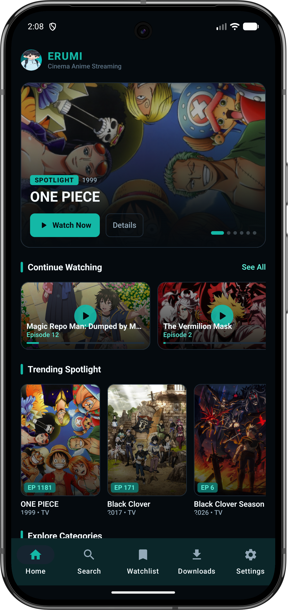
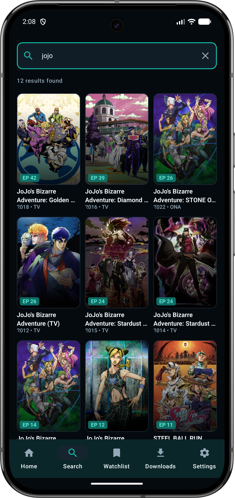
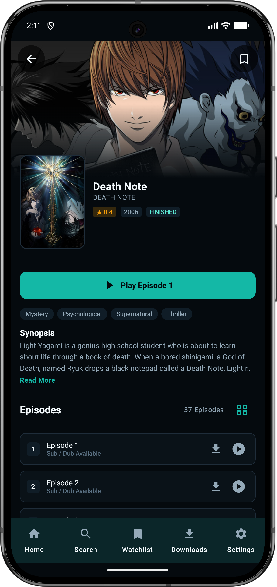
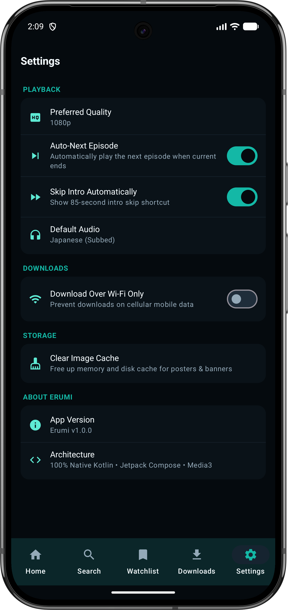
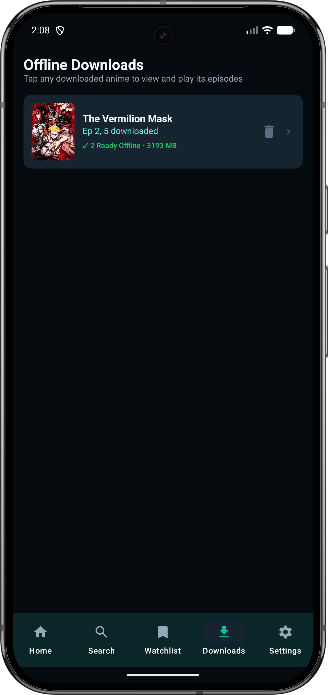
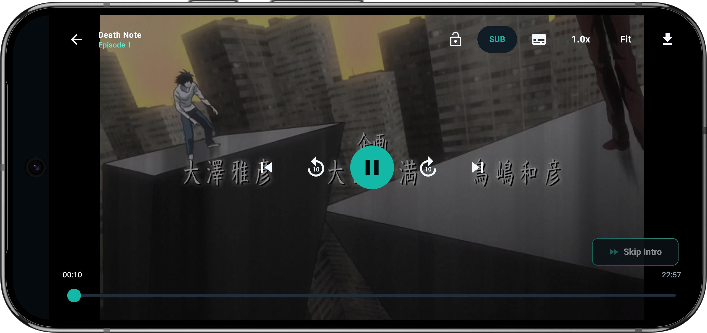

<div align="center">


# ERUMI NATIVE

**Standalone Native Android App for Anime Streaming and Manga/Manhua Reading**

[](https://kotlinlang.org/)
[](https://developer.android.com/jetpack/compose)
[](https://m3.material.io/)
[](https://developer.android.com/media/media3/exoplayer)
[-3DDC84?logo=android&logoColor=white)](https://developer.android.com/)
[](https://github.com/jhudel26/Erumi-Android-App/releases)
[](LICENSE)

*Clean Architecture · MVVM · Jetpack Compose · Kotlin Coroutines & Flow*

</div>

---

## Disclaimer

> **Educational Purpose Only**
>
> This project does not host, store, or distribute any copyrighted media. All content is resolved in real time from publicly accessible third-party sources. This codebase is intended strictly for educational and research purposes, demonstrating native Android architecture, Media3 HLS streaming, and multi-source aggregation.
>
> Users are solely responsible for ensuring their usage complies with applicable local laws and the terms of service of third-party websites.

---

## Key Features

| Feature | Description |
|---------|-------------|
| **Dual Experience** | Switch seamlessly between **Anime Streaming** and **Manga/Manhua Reading** from the selector or settings. |
| **100% Standalone** | Runs natively on Android with no companion server, desktop bridge, or WebView wrapper. |
| **Cinema Video Player** | Media3 ExoPlayer with HLS adaptive bitrate streaming, hardware acceleration, WebVTT/embedded subtitles, skip intro, and gesture controls. |
| **Unified Manga Engine** | Queries multiple manga/manhua sources in parallel, deduplicates titles, and automatically selects the best source with chapter/page fallback. |
| **Flexible Manga Reader** | Vertical webtoon scroll and horizontal (LTR/RTL) paged modes with configurable image scaling, chapter navigation, and progress sync. |
| **Offline Downloads** | Media3 foreground download service for anime episodes and WorkManager background downloads for manga chapters. |
| **Anti-Hotlinking Pipeline** | Custom `DisguiseHeaderDataSource` strips prepended PNG disguise headers (`\x89PNG...IEND`) from MPEG-TS stream segments on the fly. |
| **In-App Updater** | Cloudflare R2 manifest checker with SHA-256 and signing-certificate verification and resumable APK downloads. |
| **Local Library** | Continue watching/reading shelves, watch/read history, watchlist/library, and search history persisted locally via Room. |

---

## Screenshots

<div align="center">

| Home | Search | Anime Details |
|:---:|:---:|:---:|
|  |  |  |

| Settings | Downloads | Video Player |
|:---:|:---:|:---:|
|  |  |  |

</div>

---

## Architecture

Erumi Native follows **Clean Architecture** and **MVVM**, organized into clear feature and infrastructure layers:

```text
+-------------------------------------------------------------------+
|                        PRESENTATION LAYER                         |
|  - Jetpack Compose UI (Material 3 Dark Cinema Theme)              |
|  - ViewModels (StateFlow & Kotlin Coroutines)                     |
|  - Navigation Compose (ErumiNavGraph / MangaNavGraph)             |
+---------------------------------^---------------------------------+
                                  |
+---------------------------------v---------------------------------+
|                           DOMAIN LAYER                            |
|  - Models (Anime, Episode, StreamSource, Manga, MangaChapter)     |
|  - Shared Interfaces (MediaProgress, MediaChapter)                |
|  - Resolvers & Matchers (EpisodeResolver, FuzzyMatcher)           |
+---------------------------------^---------------------------------+
                                  |
+---------------------------------v---------------------------------+
|                            DATA LAYER                             |
|  - Anime Sources (AllAnime, AniList, HiAnime, AniDB, AniNeko)     |
|  - Manga Sources (ElfToon, AsuraScans, ManhuaPlus, FlameComics,   |
|                   Manganato, ManhuaScan)                          |
|  - Room Databases (AppDatabase & MangaDatabase) + DataStore       |
|  - Media3 DownloadService, WorkManager, & Custom DataSources      |
+-------------------------------------------------------------------+
```

### Project Structure

```text
app/src/main/java/com/erumi/nativeapp/
├── core/
│   ├── common/           # Constants, Resource wrapper (Success/Error/Loading)
│   ├── database/         # Room AppDatabase, DAOs, Entities, Converters
│   ├── datastore/        # UserPreferencesDataStore
│   ├── download/         # Media3 ErumiDownloadService & ErumiDownloadUtil
│   ├── image/            # ImageResolver, CoilConfig, Jikan & Kitsu providers
│   ├── network/          # ApiClient, DisguiseHeaderDataSource, ErumiDataSourceFactory
│   ├── updater/          # UpdateManager, UpdateChecker, ApkDownloader, ApkVerifier
│   └── utils/            # FuzzyMatcher, OtakuCipher
├── data/
│   └── repository/       # AnimeRepository, UserLibraryRepository
├── domain/
│   └── model/            # Anime, Episode, StreamSource, WatchProgress, DownloadItem
├── engine/
│   ├── sources/          # AllAnimeSource, AniListSource, HiAnimeSource, AniDBSource, AniNekoSource
│   └── resolver/         # EpisodeResolver (waterfall pipeline)
├── features/
│   ├── home/             # Spotlight carousel, continue watching, latest & popular
│   ├── search/           # Debounced search, history, popular tags
│   ├── anime_details/    # Synopsis, relations, episode grid/list, downloads
│   ├── player/           # Media3 cinema player, subtitles, gestures, skip intro
│   ├── watchlist/        # Saved anime with search & removal
│   ├── history/          # Watch history with progress tracking
│   ├── downloads/        # Offline download manager & detail view
│   ├── settings/         # Playback, download, cache, & updater controls
│   └── browse/           # Genre-filtered catalog
├── manga/
│   ├── data/             # MangaDatabase, MangaRepository, MangaDownloadWorker, Sources
│   ├── domain/           # Manga, MangaDetails, MangaChapter, MangaPage
│   ├── navigation/       # MangaNavGraph, MangaScreen
│   └── presentation/     # Home, Discover, Search, Details, Reader, Library, History, Downloads, Settings
├── shared/
│   ├── domain/models/    # MediaChapter, MediaProgress
│   ├── navigation/       # BaseNavGraph, BaseScreen
│   └── ui/               # Shared cards, states, shimmer loaders, ErumiTourOverlay
├── navigation/           # ErumiNavGraph, Screen
├── ui/                   # Splash screen, ExperienceSelectorScreen, Theme
├── ErumiApplication.kt   # Application setup & Coil ImageLoaderFactory
└── MainActivity.kt       # Entry point, insets, experience routing, update host
```

---

## Data Sources

### Anime Catalog & Streaming

| Source | Protocol | Role |
|--------|----------|------|
| **AllAnime** | GraphQL | Primary catalog, search, trending, latest, and genre browse |
| **AniList** | GraphQL | Metadata enrichment, artwork, relations, and fallback catalog |
| **HiAnime** | HTML/JSON + OtakuCipher | Primary episode lists, WebVTT subtitles, Sub/Dub streams |
| **AniDB** | REST + Embed Scraper | Secondary stream fallback |
| **AniNeko** | HTML Scraper | Tertiary stream fallback |

### Manga / Manhua Sources (Unified Auto Engine)

When **Auto (Best Source)** is active (default), `MangaRepository` queries all registered sources in parallel, deduplicates matching titles, selects the best candidate by cover quality, chapter count, and source priority, and falls back automatically if a chapter or page fails to load.

| Source | Protocol | Base URL |
|--------|----------|----------|
| **Elf Toon** | Next.js SSR / HTML | `https://elftoon.net` |
| **AsuraScans** | HTML / Astro Scraper | `https://asurascans.com` |
| **ManhuaPlus** | HTML / AJAX Scraper | `https://manhuaplus.org` |
| **FlameComics** | Next.js SSR Scraper | `https://flamecomics.xyz` |
| **Manganato** | HTML / REST Scraper | `https://www.manganato.gg` |
| **ManhuaScan** | HTML Scraper | `https://manhuascan.us` |

---

## Tech Stack

| Category | Library / Tool | Version |
|----------|---------------|---------|
| **Language** | Kotlin | 1.9.22 |
| **UI** | Jetpack Compose + Material 3 | BOM 2024.02.00 |
| **Navigation** | Navigation Compose | 2.7.7 |
| **Media** | AndroidX Media3 (ExoPlayer, HLS, UI, Session, Database) | 1.3.0 |
| **Networking** | OkHttp | 4.12.0 |
| **Parsing** | Gson / Jsoup | 2.10.1 / 1.17.2 |
| **Images** | Coil Compose | 2.6.0 |
| **Persistence** | AndroidX Room / DataStore | 2.6.1 / 1.0.0 |
| **Background Work** | AndroidX WorkManager | 2.9.0 |
| **Async** | Kotlin Coroutines | 1.7.3 |
| **Android SDK** | Min SDK 26 / Target SDK 34 | Java 17 |

---

## Getting Started

### Prerequisites

- **JDK 17** or higher
- **Android SDK** (API 34 / Android 14)
- **Gradle 8.3+** (wrapper included)

### Clone & Build

```bash
git clone https://github.com/jhudel26/Erumi-Android-App.git
cd Erumi-Android-App

# Build Debug APK (Linux/macOS)
./gradlew assembleDebug

# Build Debug APK (Windows)
gradlew.bat assembleDebug
# Or use the helper script:
build_apk.bat
```

Output: `app/build/outputs/apk/debug/app-debug.apk`

### Build Release APK

```bash
./gradlew assembleRelease
```

### Run Unit Tests

```bash
./gradlew testDebugUnitTest
```

### Install via ADB

```bash
adb install app/build/outputs/apk/debug/app-debug.apk
```

---

## Release History

### Version 1.4.2
- Upgraded Manga/Manhua module to a unified multi-source **Auto (Best Source)** engine with parallel aggregation, title deduplication, and automatic chapter/page fallback.
- Fixed Elf Toon chapter page extraction (`p[0-9]*-` pattern in RSC payload) and detail cover image decoding (`/_next/image` URLs).
- Updated Manga Reader Prev/Next buttons to display target chapter numbers (e.g., `Chapter 3` / `Chapter 5`).
- Fixed player touch-lock unlock interaction, skip-intro state tracking, and `"off"` subtitle preference handling.
- Fixed tour overlay `dp`/`px` positioning, observable hero carousel state maps, manga navigation ID-to-URL resolution, and episode title cleaning.

### Version 1.4.1
- Added **Elf Toon** manga source and updated updater configuration.

### Version 1.4.0
- Added Cloudflare R2 self-updater with SHA-256 and certificate verification.
- Added Manganato search 403 catalog fallback and Manga hero carousel.

### Version 1.3.0
- Preserved Room database across migrations, improved `DisguiseHeaderDataSource` 64 KB buffering, parallelized subtitle downloads, and added watchlist/history search.

---

## License

Distributed under the **MIT License**. See [LICENSE](LICENSE) for more information.

---

<div align="center">

Developed by [jhudel](https://jhudel.vercel.app/)

[](https://github.com/jhudel26/Erumi-Android-App/stargazers)
[](https://github.com/jhudel26/Erumi-Android-App/network/members)
[](https://github.com/jhudel26/Erumi-Android-App/issues)

</div>
